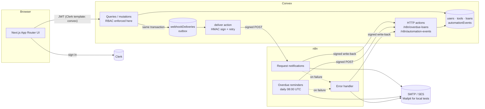

# LendLoop

[](https://github.com/ayenisholah/fluencetraining/actions/workflows/ci.yml)
[](https://github.com/ayenisholah/fluencetraining/actions/workflows/codeql.yml)
[](LICENSE)
[](SECURITY.md)

> Borrow what you need. Lend what you don't.

A neighbourhood tool-lending board. Neighbours list tools, request to borrow them for a date range, and approve, decline and close out loans. n8n handles the notifications and overdue reminders.

**Live demo:** https://lendloop.sholaayeni.xyz · [Try it in ten minutes](#try-it)

**Stack:** Next.js 16 (App Router) · TypeScript · Clerk · Convex · n8n · Tailwind CSS 4 · Frox design system · Vitest, Testing Library, Storybook 10, Playwright

---

## Contents

1. [Try it](#try-it)
2. [What it does](#what-it-does)
3. [Architecture](#architecture)
4. [Local setup](#local-setup)
5. [Environment variables](#environment-variables)
6. [Roles and access control](#roles-and-access-control)
7. [n8n workflows](#n8n-workflows)
8. [Security and data-minimisation decisions](#security-and-data-minimisation-decisions)
9. [Design system](#design-system)
10. [Testing](#testing)
11. [AWS production infrastructure](#aws-production-infrastructure)
12. [What I would change for production](#what-i-would-change-for-production)
13. [Full documentation](docs/README.md): user stories, architecture, ADRs, threat model, test plan, runbook, release checklist

## Try it

**Live demo: https://lendloop.sholaayeni.xyz**

A ten-minute walkthrough of the brief, using two accounts (one normal window, one private window):

1. **Signed out:** open the home page. It lists tool names and categories only, with a "Sign in to lend or borrow" button.
2. **Account A:** sign up, then add a tool under **My listings**.
3. **Account B:** sign up, find the tool under **All tools**, and request it for a date range.
4. **Account A:** open **Incoming** and approve. The tool now shows as on loan for both accounts.
5. **Account A:** mark the loan returned. Each loan card shows its recent automation activity, e.g. "Notification sent just now".

**Email on the live site:** Amazon SES is still in its sandbox, so it only delivers to verified addresses. If you're reviewing this application and want the emails, reply to my submission email with the addresses you'll sign up with. AWS sends each one a verification link to click. For an unverified address the app works normally, SES rejects the email, and the failure appears in Admin › Automation health. The local stack has no such limit, because Mailpit catches everything.

**Admin on the live site:** roles can only be changed by an operator, by design, so there's no self-service route. Reply with the account you signed up with and I'll promote it. Locally, run the [`users:setRole` command](#4-run-it). The overdue reminders and failure handling are easiest to try on the [local stack](#trying-the-automations).

**Where to look in the code:**

| Topic | Start here |
|---|---|
| Role and ownership rules | `convex/lib/auth.ts`, and `convex/access.test.ts`, which fails if a public function has no guard |
| Transactional outbox and retries | `convex/lib/outbox.ts`, `convex/webhooks.ts` |
| Signed endpoints and idempotent write-backs | `convex/lib/hmac.ts`, `convex/http.ts`, `convex/automation.ts` |
| n8n workflows and their tests | `n8n/workflows/`, `n8n/roundtrip.test.ts` |
| Decisions and tradeoffs | [Security decisions](#security-and-data-minimisation-decisions), [production note](#what-i-would-change-for-production), [ADRs](docs/architecture/adr/README.md) |

## What it does

| Area | Details |
|---|---|
| Public page | Tagline, a read-only list of available tools (**name and category only**), and a "Sign in to lend or borrow" button wired to Clerk. |
| All tools | Every listed tool with availability, filterable by category. Each card shows the lender's first name and a Trusted Lender badge. You can request a tool for a date range. |
| My listings | Create, edit and delete your own tools (name, category, condition, short description). |
| My requests | Your borrow requests with status, an overdue flag, and the latest automation activity, e.g. "Reminder sent 2 days ago". Cancel open requests here. |
| Incoming requests | Requests for your tools. Approve, decline, or mark returned. |
| Admin | All loans, every listing with removal, the Trusted Lender toggle, and an **automation health** panel listing failed or pending webhooks (with retry) and n8n workflow errors. |

## Architecture



**Request flow:** a borrower requests a tool.
1. `loans.request` validates the request and inserts the loan. In the **same transaction** it writes an outbox row and schedules `webhooks.deliver`. If the mutation rolls back, no webhook is ever sent.
2. `deliver` builds a minimal payload from current data, signs it, and POSTs it to the n8n webhook.
3. n8n verifies the signature, emails the lender, responds 200, and writes a signed `request_notification` event back to Convex.
4. The lender's Incoming page shows "Notification sent just now".

**Overdue flow:**
1. Every day n8n POSTs a signed request to `/n8n/overdue-loans`.
2. Convex returns approved loans past their end date that **haven't been reminded today**.
3. n8n emails each borrower and writes back one event per loan with the idempotency key `overdue:<loanId>:<date>`.

Directory map:

```
app/(site)/          public pages: landing, privacy, terms
app/(app)/           signed-in pages: tools, listings, requests, incoming, admin
components/ui/       design-system components (each with tests and stories)
components/shell/    app shell (sidebar), site header, footer
components/          domain components: ToolForm, BorrowForm, LoanCard, screens
lib/                 pure helpers: theme, nav, loan status, formatting, contrast
e2e/                 Playwright suites
.storybook/          Storybook config (theme toolbar, a11y as errors)
convex/
  schema.ts          tables + indexes
  lib/auth.ts        requireUser / requireAdmin / requireToolOwner / requireLoanParty
  lib/hmac.ts        signing + constant-time verification (Web Crypto)
  tools.ts loans.ts admin.ts users.ts
  webhooks.ts        outbox delivery, retries with backoff
  http.ts            endpoints n8n calls
  automation.ts      overdue query + idempotent write-back
  dev.ts             internal-only test helper (back-date a loan)
  *.test.ts          convex-test suites
n8n/workflows/       exported workflow JSON (no credentials inside)
n8n/credentials/     local Mailpit SMTP credential (no secret: Mailpit has no auth)
scripts/             setup, n8n import/export, AWS deployment helpers
infra/               CDK stacks: backend, web, observability, deployer
deploy/ec2/          production Compose, Caddy, bootstrap and metrics
docker-compose.yml   Convex (self-hosted), Convex dashboard, n8n, Mailpit
```

## Local setup

**You need:** Docker, Node 22 with npm 10 (`nvm use` reads `.nvmrc`), Python 3 (for n8n provider imports), and a Clerk development instance.

The default development stack runs locally except for Clerk. Selecting SES also connects n8n to AWS for email. Convex is **self-hosted in Docker** so that it and n8n can call each other on the compose network. With Convex cloud, the cloud could not reach a webhook on `localhost`.

### 1. Install and start the stack

```bash
npm install
npm run setup
```

`npm run setup` (see `scripts/setup.sh`) does the following, and is safe to re-run:

- Writes `.env` with fresh random secrets.
- Starts Convex, the Convex dashboard, n8n and Mailpit.
- Generates a Convex admin key into `.env.local`.
- Sets the Convex environment variables and deploys the Convex functions.
- Imports, publishes and restarts the n8n workflows.

### 2. Create the Clerk application

1. In the [Clerk dashboard](https://dashboard.clerk.com), create an application (email sign-in is enough).
2. Copy the **Publishable key** and **Secret key** into `.env.local`.
   Under **Configure → User & authentication**, turn on **First and last name** and make it required. Otherwise email-code sign-ups have no name and appear as "Neighbour".
3. Go to **Configure → JWT templates → New template → Convex**. Keep the name `convex`. The template's default claims include `email` and `name`; LendLoop needs `email` to send notifications.

### 3. Point Convex at Clerk

Copy the template's **Issuer** URL (your Frontend API URL, e.g. `https://xxx.clerk.accounts.dev`), then run:

```bash
npx convex env set CLERK_JWT_ISSUER_DOMAIN https://xxx.clerk.accounts.dev
npx convex dev --once
```

### 4. Run it

```bash
npm run dev          # http://localhost:3000
npm run convex       # optional: watch mode that redeploys Convex functions on save
```

Sign in, then make yourself an admin:

```bash
npx convex run users:setRole '{"email":"you@example.com","role":"admin"}'
```

| Service | URL |
|---|---|
| App | http://localhost:3000 |
| Mailpit (default local test mail) | http://localhost:8025 |
| n8n | http://localhost:5678 (create the local owner on first visit) |
| Convex dashboard | http://localhost:6791 (admin key from `.env.local`) |

### Sample data

Fill the board with a believable neighbourhood: four neighbours and 100 tools covering every category. It's safe to re-run, because anything that already exists is skipped.

```bash
npm run seed
```

The seeded neighbours are `role: "user"` with `@lendloop.local` addresses, so their notifications land in Mailpit. They can't sign in, so they exist only to lend. Each e2e spec deletes its own "E2E …" tool when it finishes. If an interrupted run leaves some behind, this removes them along with their loans and activity:

```bash
npx convex run dev:purgeTestData '{"prefix":"E2E "}'
```

The seed adds missing sample tools without changing existing listings or user data. Lists fetch one page at a time from the server, with Previous/Next controls and page sizes of 10 (default), 25, 50 or 100. Changing search, filters or page size returns to page 1.

Both are `internalMutation`s, so only someone with the Convex admin key can run them.

### Trying the automations

- **Notifications:** sign in as two users (one normal window, one private window). List a tool as one, request it as the other, and watch Mailpit.
- **Overdue reminders:** approve a loan, back-date it, and run the workflow now instead of waiting for 08:00 UTC:
  ```bash
  npx convex run dev:backdateLoan '{"loanId":"<id>"}'
  docker compose exec -e N8N_RUNNERS_BROKER_PORT=5699 n8n n8n execute --id=LendLoopRemindWf
  ```
  Alternatively, open the workflow in n8n and click **Execute workflow**. Run it a second time and no new email is sent.
- **Failure handling:**
  - `docker compose stop n8n`, then make a request. The delivery shows as pending in Admin with the error and next retry time.
  - `docker compose start n8n`, and it is delivered on the next attempt.
  - Stop `mailpit` instead, and the error workflow records a `workflow_error` that appears in Admin.

## Environment variables

**`.env`** (read by docker compose; generated by `npm run setup`):

| Variable | Purpose |
|---|---|
| `CONVEX_INSTANCE_SECRET` | Self-hosted Convex instance secret |
| `N8N_ENCRYPTION_KEY` | Encrypts n8n credentials at rest |
| `LENDLOOP_TO_N8N_SECRET` | HMAC secret: Convex signs webhooks, n8n verifies |
| `N8N_TO_LENDLOOP_SECRET` | HMAC secret: n8n signs calls to Convex, Convex verifies |
| `LENDLOOP_APP_URL` | Links in emails |
| `LENDLOOP_OPS_EMAIL` | Where the error workflow sends alerts |

**`.env.local`** (Next.js and the Convex CLI):

| Variable | Purpose |
|---|---|
| `CONVEX_SELF_HOSTED_URL`, `CONVEX_SELF_HOSTED_ADMIN_KEY` | Convex CLI target |
| `NEXT_PUBLIC_CONVEX_URL` | Convex client URL |
| `NEXT_PUBLIC_CLERK_PUBLISHABLE_KEY`, `CLERK_SECRET_KEY` | Clerk |
| `NEXT_PUBLIC_SITE_URL` | Canonical URLs, sitemap, social previews (default `http://localhost:3000`) |
| `NEXT_PUBLIC_PLAUSIBLE_DOMAIN`, `NEXT_PUBLIC_PLAUSIBLE_SRC` | Optional cookie-free analytics, loaded only after consent |
| `ENFORCE_HTTPS` | `true` behind a TLS proxy to redirect http → https (not needed on Vercel) |

**Convex deployment env** (`npx convex env set`; set by `npm run setup` except Clerk):

| Variable | Purpose |
|---|---|
| `CLERK_JWT_ISSUER_DOMAIN` | Issuer Convex trusts for Clerk JWTs |
| `N8N_WEBHOOK_URL` | n8n production webhook URL |
| `LENDLOOP_APP_URL` | Public app URL for links and the logo in emails (set by `npm run setup`) |
| `LENDLOOP_TO_N8N_SECRET`, `N8N_TO_LENDLOOP_SECRET` | Same values as `.env` |

## Roles and access control

Roles are stored on the Convex `users` row (`admin` | `user`). New users are always created as `user`, and the role is **never** read from the client or from token claims. The only way to grant admin is `users:setRole`. It is an `internalMutation`, so only an operator with the deployment's admin key can call it.

Every public Convex function starts with one of the helpers in `convex/lib/auth.ts`:

| Action | Rule (enforced in Convex) |
|---|---|
| See the public tool list | Anyone; returns `{ name, category }` only |
| Browse, request, see own requests | Signed in |
| Edit / delete a listing | `requireToolOwner` |
| Approve / decline / mark returned | `requireLoanParty(…, "lender")` |
| Cancel a request | `requireLoanParty(…, "borrower")` |
| Remove any listing, view all loans, Trusted Lender, retry webhooks | `requireAdmin` |

Business rules enforced on the server:
- Dates are real calendar dates, not in the past, with the end after the start and at most 30 days apart.
- You can't borrow your own tool, or open two requests for the same tool.
- A tool has one active loan at a time, and overlapping requests are rejected.
- Removing a listing declines its open requests, and the borrowers are notified.
- An owner can't remove a tool while it's on loan. An admin can, for moderation: the loan stays open so the lender can still mark it returned.

The Next.js `proxy.ts` redirects signed-out visitors away from app pages. That is a UX convenience; it is not the access control.

## n8n workflows

| File | Trigger | What it does |
|---|---|---|
| `01-request-notifications.json` | Webhook `POST /webhook/lendloop-loan-events` | Verifies the HMAC over the raw body, responds 401 if invalid, and acknowledges duplicate deliveries without re-sending. Then checks the payload carries its rendered email, sends it (HTML + text), responds 200, and writes a signed `request_notification` event to Convex. |
| `02-overdue-reminders.json` | Schedule (daily 08:00 UTC) + manual | Makes a signed fetch of overdue loans (each with its rendered reminder), then sends one reminder per loan (HTML + text). Write-backs are signed and idempotent, recording `sent`/`failed` per loan. Finally it fails the run if any reminder failed, so the error workflow fires. |
| `03-error-handler.json` | Error Trigger (set as the error workflow of the other two) | Emails ops a summary (workflow, node, message; no item data) and records a `workflow_error` in Convex, shown in Admin. |

**Email templates.** Messages are rendered in Convex, not in n8n: `convex/lib/email/` holds a table-based, inline-styled branded layout (LendLoop header, coloured status banner, a loan-details card with the category in its preset colour, call-to-action buttons, footer) and one template per event plus the overdue reminder, each with a plain-text alternative. They are typed and unit-tested, every piece of user text is HTML-escaped, and the colours are checked against the app's tokens. Convex sends `{ subject, html, text }` with the signed payload, so n8n only verifies and sends. Preview them all with `npm run email:preview` (writes `email-previews/`).

Reliability measures:
- **Convex → n8n:**
  - The outbox row is committed with the state change.
  - Delivery has a 10 s timeout.
  - Network errors, 5xx, 408 and 429 are retried with backoff (30 s, 2 m, 8 m, 32 m; 5 attempts).
  - Other 4xx responses, such as a bad signature, fail immediately because retrying won't help.
  - Failed deliveries are listed in Admin with a Retry button.
- **n8n nodes:** HTTP and email nodes use retry-on-fail (3 tries).
- **Duplicate handling:**
  - **Records are idempotent.** Every write-back is keyed: `notify:<deliveryId>`, `overdue:<loanId>:<date>` or `error:<executionId>`. Convex upserts by key inside a serializable mutation, so retries and re-runs never create duplicate records. A later `sent` upgrades an earlier `failed`.
  - **Emails are deduplicated on a best-effort basis.** The notification workflow remembers handled `deliveryId`s in workflow static data, the last 1,000, so a Convex retry after a lost response normally doesn't email twice. n8n saves static data only when a run ends, so two *overlapping* runs of the same delivery could both send. That's rare, because Convex retries after at least 30 s. The overdue query skips loans already reminded today, and that filter runs while scanning, so a partial run never starves later loans. If SMTP accepts a reminder but the write-back then fails, a re-run the same day can send it again.
  - **Ordering:** the webhook is acknowledged after the email is sent and *before* the activity write-back. Acknowledging later would turn a slow write-back into a Convex retry, which means a duplicate email. If the write-back exhausts its retries, the email went out but the loan shows no activity. The error workflow reports that run to ops and to Admin › Automation health.
  - The production fix for all three is an atomic "claim" in Convex before sending (see [What I would change for production](#what-i-would-change-for-production)).

To refresh the exported JSON after editing in the n8n UI, run `npm run n8n:export`. It strips instance-specific fields and fails if any secret value from `.env` appears in the output.

## Security and data-minimisation decisions

- **Authorisation lives in Convex functions.** Every function checks identity, ownership or role. The UI only hides buttons the server would refuse anyway, and tests call the functions directly as other users to prove this.
- **Signed integration in both directions.**
  - Signing scheme: HMAC-SHA256 over `${timestamp}.${rawBody}`, sent as `x-lendloop-timestamp` and `x-lendloop-signature: sha256=<hex>`.
  - Verification uses constant-time comparison and a 5-minute replay window.
  - n8n verifies the **raw bytes** it received, not re-serialised JSON.
  - There are **two secrets, one per direction**, so a signature made for one direction is never valid in the other, and each secret can be rotated on its own. HMAC is symmetric, so Convex and n8n each hold both secrets: this doesn't protect against a compromised Convex or n8n.
- **Secrets stay out of code and exports.**
  - Secrets live in `.env`, which is git-ignored and generated locally, in Convex deployment env, and in n8n credentials and container env.
  - Workflow JSON only references `$env.*` and a credential id.
  - CI and `n8n:export` check that exports contain no secret values.
- **Minimal payloads.**
  - Webhooks are built at send time from IDs in the outbox, so the queue holds no personal data.
  - A webhook carries one recipient's email and first name, the other party's first name, the tool name and the dates. It never includes descriptions or the other party's email.
  - The overdue endpoint returns only what a reminder needs.
  - The error workflow doesn't copy item data into alerts.
- **Need-to-know in the UI.**
  - The public page shows only tool name and category.
  - Signed-in users see a lender's first name, never their email.
  - Only admins see full names and emails.
- **Server decides time.** The overdue endpoint ignores any date in the request and uses the server clock, so a caller can't widen the query.
- **Input is plain text and bounded.**
  - Field lengths are validated on the server.
  - Tool names and descriptions reject control characters and bidi overrides (`convex/lib/rules.ts`, shared with the form). They reach email subjects through n8n, where CR/LF could split headers, and bidi overrides can make text display as something it isn't.
  - Display names from Clerk are cleaned the same way and capped before they're stored.
  - HTTP bodies are capped at 16 KB, measured in bytes, and a declared oversized body is refused before it's read.
  - Write-back payloads are validated against an allow-list of kinds.
- **Local stack binds to 127.0.0.1 only.** Mailpit's SMTP port isn't published at all.
- **Strict Content-Security-Policy.**
  - `proxy.ts` uses Clerk's strict CSP: a fresh nonce per request and `'strict-dynamic'` for scripts, with no host allow-lists.
  - `connect-src` is limited to the app, Clerk and the Convex deployment, including its websocket.
  - The policy also sets `frame-ancestors 'none'`, `object-src 'none'` and `base-uri 'self'`.
  - Next.js and Clerk add the nonce to their own scripts. The one inline script, which sets the theme before paint, gets it from the layout.
  - Playwright checks the header and that no page, including Clerk's sign-in and the signed-in app, triggers a violation.
- **Baseline headers.** The app also sends `X-Frame-Options: DENY`, `nosniff`, a strict referrer policy, a restrictive `Permissions-Policy`, and HSTS in production.
- **The HTTPS redirect doesn't trust the request.** With `ENFORCE_HTTPS=true`, plain-http requests are redirected to the configured `NEXT_PUBLIC_SITE_URL`. `Host` and `X-Forwarded-Host` are client-controlled and could otherwise turn the redirect into an open redirect or poison a cache.
- **Dependencies.** `npm audit --omit=dev` reports no vulnerabilities in what ships. The remaining advisories are in dev-only tooling (`glob`/`minimatch` ReDoS via linters and test runners).

## Design system

The UI implements the **Frox dashboard design system**. The spec and implementation notes are in [docs/design-systems/design-system.md](docs/design-systems/design-system.md):
- Tokens come straight from the Figma file and live in `app/globals.css`, exposed as Tailwind 4 theme values.
- Day and night themes switch via `data-theme`, defaulting to the OS setting.
- Poppins is the typeface.
- A component library lives in `components/ui`: Button, Control, SegmentedControl, TextField, Select, Toggle, Checkbox, Radio, RangeSlider, Badge, Avatar, Card, StatWidget, DropdownMenu, SidebarItem, Alert, EmptyState, Spinner, PageHeader and icons.

Where a Figma colour pairing failed WCAG AA, only the semantic alias the components use was adjusted. Each change is listed next to its Figma value in the doc.

```bash
npm run storybook        # http://localhost:6006: every component, variant and state
npm run build-storybook  # static build in storybook-static/
```

## Testing

For local notification troubleshooting, prerequisites and a manual two-account smoke test,
see the [automation runbook](docs/operations/runbook.md#verify-local-notifications).

```bash
npm test                 # Vitest: Convex backend (edge-runtime) + components and lib (jsdom)
npm run test:storybook   # every story in Chrome: render, play function, axe
npm run test:e2e         # Playwright (builds and starts the app)
npm run test:e2e:public  # signed-out suite only
npm run test:automation  # local email + recovery suite; temporarily stops/restores Mailpit
npm run typecheck && npm run lint
npm run check:contrast   # WCAG AA for the design tokens in both themes
```

| Suite | What it covers |
|---|---|
| `convex/rbac.test.ts` | Public list leaks only name and category; owner-only edit and delete; lender-only approve, decline and return; borrower-only cancel; admin-only functions and stats; no self-borrowing; date validation; overlap rule; new users are never admins; each state change queues exactly one outbox row; per-user hourly limits on listings and requests. |
| `convex/automation.test.ts` | Rejects unsigned, wrongly signed and stale requests; overdue payload is minimal; idempotent write-back; reminded loans are hidden on re-run; a `failed`→`sent` upgrade; malformed input. Webhook signing, payload contents (no description, no other party's email), backoff retries, no retry on 4xx, admin retry, and failure when configuration is missing. |
| `convex/hmac.test.ts`, `convex/rules.test.ts` | Signing round-trip, tamper and replay detection, parity with the Node `crypto` used in n8n; the shared validation rules. |
| `components/**/*.test.tsx` | Every component's variants, states (disabled, loading, error), keyboard behaviour (segmented control, menu, toggle), ARIA wiring and an axe pass; LoanCard actions per viewer; ToolForm and BorrowForm validation, focus and submit. |
| `lib/lib.test.ts` | Theme storage, nav by role, loan status mapping, formatting, contrast maths, class merging. |
| `components/**/*.stories.tsx` | Every story runs as a browser test with axe set to fail on violations, including colour contrast. |
| `e2e/public.spec.ts` | Desktop and mobile: landing CTA, consent persistence, theme persistence, legal pages, real 404, auth redirect, no horizontal scroll, axe in light and dark. |
| `e2e/signed-in.spec.ts` | With `@clerk/testing` and two Clerk test users: non-admins can't reach Admin, listing validation, then lend → request → approve → "On loan" on both sides → notification activity → returned. Then axe on every signed-in page. It needs the local stack (`npm run setup`) and Clerk keys in `.env.local`, and is skipped without them. |

On the local stack I also ran each automation scenario end to end: request and approval emails, the overdue reminder and an idempotent re-run, a bad secret (401, failed, retried from Admin), n8n down (retried and delivered), and Mailpit down (error workflow fires and the delivery recovers).

Release gates (tests, contrast, links, bundle, security, docs) are in the [release checklist](docs/operations/release-checklist.md), with Lighthouse results in [docs/lighthouse/summary.md](docs/lighthouse/summary.md). The [docs index](docs/README.md) lists every lifecycle document.

## AWS production infrastructure

The repository defines production in AWS account `571787168993`, region `eu-north-1`, at **https://lendloop.sholaayeni.xyz**:

- **Amplify Hosting:** Next.js SSR, building the `main` branch.
- **EC2:** one ARM64 `t4g.small` host with encrypted EBS, running self-hosted Convex, n8n and Caddy through Docker Compose.
- **Secrets Manager and Systems Manager:** service secrets, deployment parameters, host access and refreshes without SSH.
- **CloudWatch, Synthetics and SNS:** logs, metrics, dashboard, endpoint checks and alarm routing, emailed to the address in the `ALERT_EMAIL` repository variable.
- **AWS Backup:** daily host backups with seven-day retention.
- **Amazon SES:** SMTP sender `LendLoop <notifications@sholaayeni.xyz>`. Namecheap hosts DNS; Clerk provides user authentication.
- **CDK / CloudFormation, S3 and IAM:** four application stacks, deployment bundles and GitHub deployment permissions.

Start with the [AWS infrastructure and deployment guide](docs/operations/aws-deployment.md), [monitoring guide](docs/operations/observability.md), and [SES SMTP guide](docs/operations/ses-smtp.md). These describe the code-defined configuration, not a fresh audit of live AWS resources.

**Email:** production n8n sends through Amazon SES; Mailpit is only for local tests. See [SES SMTP › Production](docs/operations/ses-smtp.md#production-ec2).

## What I would change for production

This runs on one small host inside an AWS free plan, which suits a demo. For real users, in priority order:

1. **Email:** get SES production access (it's still in the sandbox) and move DMARC from `p=none` to enforcement once the domain has a sending reputation.
2. **Delivery guarantees:** add an atomic "claim" in Convex before each send, and reconcile activity write-backs that fail after the email went out. That closes the three gaps listed under [Duplicate handling](#n8n-workflows).
3. **Availability and recovery:** replace the single host with managed or multi-host Convex and n8n in queue mode, set recovery targets, and test a restore. Daily backups run, but no restore has been tested.
4. **Privacy:** self-service account deletion and data export. Today deletion is a manual operator process.
5. **Auditability:** record who did what for admin actions (removals, Trusted Lender, role changes), add an audited admin-management UI, and turn on a CloudTrail trail.
6. **Secrets:** dual-key HMAC rotation, so a secret can change with no failed deliveries.
7. **Scale:** replace the counting scans behind numbered pagination with aggregates or cursors, and page through overdue loans beyond the current 4,000-loan scan limit.
8. **Product:** notification preferences, and bookings for future dates. Approving a request currently marks the tool on loan straight away.
