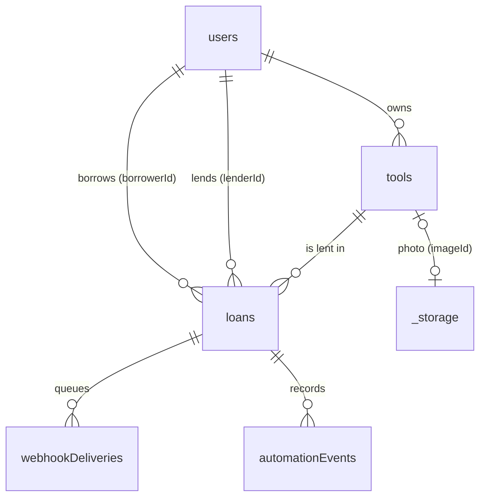

# Data model

Source of truth: [`convex/schema.ts`](../../convex/schema.ts). Convex adds `_id` and `_creationTime` to every document.

## users
| Field | Type | Notes |
|---|---|---|
| `tokenIdentifier` | string | Clerk issuer + subject; the only identity link |
| `name` | string | Cleaned and capped on store (`cleanDisplayName`) |
| `email` | string? | From the Clerk token; shown to admins only |
| `role` | `"user" \| "admin"` | Always `user` on creation; changed by operator CLI only |
| `trustedLender` | boolean | Set by admins |
| `searchText` | string? | Derived: name + email (admin search) |

Indexes: `by_token`, `by_email`, `by_role`, `by_trusted`; search index `search` on `searchText` filtered by `role`, `trustedLender`.

## tools
| Field | Type | Notes |
|---|---|---|
| `ownerId` | id(users) | Set on the server from the caller |
| `name`, `description` | string | 2–80 and ≤ 500 chars; plain text only (`convex/lib/rules.ts`) |
| `category` | 7 literals | Presentation in `lib/categories.tsx` |
| `condition` | `new \| good \| fair \| worn` | |
| `status` | `available \| on_loan \| removed` | Soft delete via `removed` |
| `removedBy` | id(users)? | Audit of who removed it |
| `imageId` | id(_storage)? | Checked by `convex/lib/images.ts` |
| `searchText`, `listed` | derived | Kept in sync by `convex/lib/toolRecord.ts` |

Indexes: `by_status`, `by_category_status`, `by_owner`, `by_owner_status`, `by_owner_listed`, `by_listed`, `by_listed_category`, `by_image`; search index `search` on `searchText` filtered by `listed`, `status`, `category`, `ownerId`.

## loans
| Field | Type | Notes |
|---|---|---|
| `toolId`, `borrowerId`, `lenderId` | ids | Borrower is the caller; lender is the tool's owner |
| `startDate`, `endDate` | `YYYY-MM-DD` | UTC calendar dates, compared as strings; ≤ 30 days |
| `status` | `requested \| approved \| declined \| cancelled \| returned` | See the state diagram in [overview.md](overview.md) |
| `decidedAt`, `returnedAt` | number? | Timestamps |
| `toolName`, `phase` | derived | Kept in sync by `convex/lib/loanRecord.ts` |

Indexes: `by_borrower`, `by_lender`, `by_borrower_phase`, `by_lender_phase`, `by_phase`, `by_tool`, `by_tool_status`, `by_status_end` (overdue scan); search index `search` on `toolName` filtered by `lenderId`, `borrowerId`, `phase`.

## webhookDeliveries (outbox)
`loanId`, `event` (`loan.requested|approved|declined|cancelled|returned`), `status` (`pending|delivered|failed`), `attempts`, `lastError?`, `nextAttemptAt?`, `deliveredAt?`. Holds references only: the payload is built at send time. Indexes `by_status`, `by_loan`.

## automationEvents (write-backs)
`idempotencyKey` (unique by convention: `notify:<deliveryId>`, `overdue:<loanId>:<date>`, `error:<executionId>`), `loanId?`, `kind` (`request_notification|overdue_reminder|workflow_error`), `status` (`sent|failed`), `detail?` (≤ 500 chars), `at`. Indexes `by_key`, `by_loan`, `by_kind`.

## Invariants
- A tool has at most one `approved` loan; approving checks `by_tool_status`.
- `listed === (status !== "removed")` and `phase === loanPhase(status)`, maintained by the helpers; `migrations:backfillSearch` repairs older rows.
- A storage file belongs to at most one tool (`by_image`).
- Removing a tool declines its open requests and deletes its photo; an active loan on it stays open.

## Deletion and retention
- Listings are soft-deleted (`removed`), so loan history keeps its tool name.
- Photos are hard-deleted when replaced, removed, or the listing is removed; orphans older than a day go nightly (`convex/crons.ts`).
- Test data (`E2E …`) is hard-deleted by `dev:purgeTestData`.
- Retention limits for events and delivered outbox rows are a production to-do (README).
