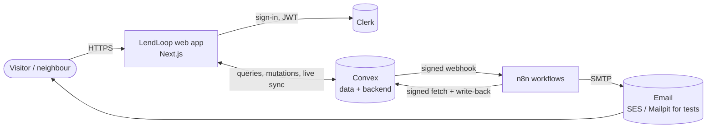
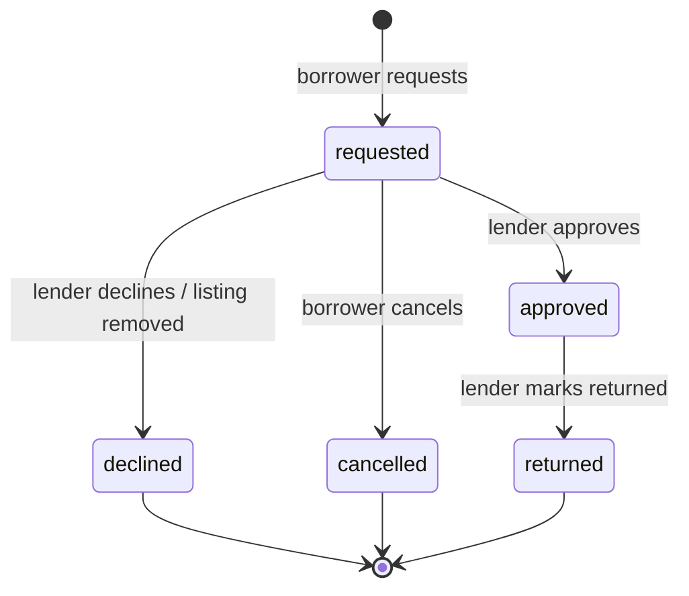
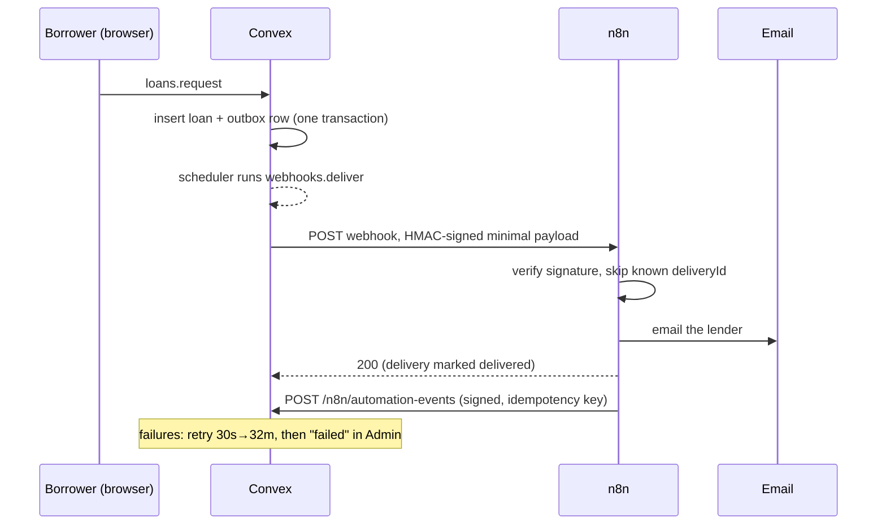
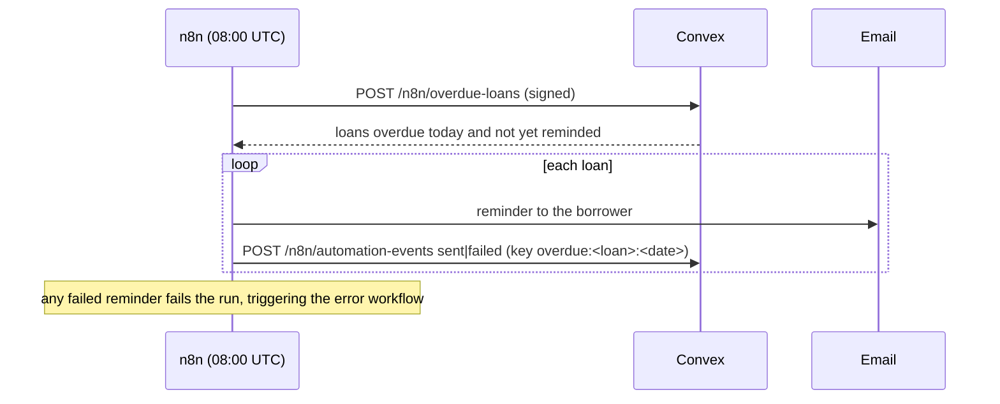

# Architecture overview

## Context



## Containers

| Container | Responsibility | Code |
|---|---|---|
| **Next.js app** | Pages, UI, CSP and route protection. Holds no business rules; every rule is re-checked in Convex. | `app/`, `components/`, `lib/`, `proxy.ts` |
| **Clerk** | Identity: sign-in, sessions, the JWT Convex trusts. Roles are *not* stored in Clerk. | `app/layout.tsx`, `convex/auth.config.ts` |
| **Convex** | Database, queries and mutations, file storage, scheduled functions, HTTP endpoints for n8n. All authorisation lives here. | `convex/` |
| **n8n** | Request notifications, daily overdue reminders and the error workflow. | `n8n/workflows/` |
| **SMTP** | SES delivery when configured; Mailpit captures local test mail. | `scripts/n8n-provider.py` |

## AWS deployment

Next.js runs on Amplify Hosting. Convex and n8n share an EC2 host with Caddy HTTPS routing and encrypted EBS-backed Docker volumes. Clerk provides authentication; Namecheap hosts DNS. Secrets Manager supplies service secrets, SSM provides host access/configuration, S3 holds CDK assets, and AWS Backup snapshots the host. CloudWatch logs/metrics, Synthetics canaries and an SNS alarm topic provide the code-defined monitoring layer.

See the [complete AWS inventory](../operations/aws-deployment.md) and [observability configuration](../operations/observability.md). Local SES configuration is separate from EC2: production bootstrap currently reimports Mailpit templates. The AWS guide records that deployment gap and the single-host availability limits.

## Code layout

```
app/                 routes; (site) public pages, (app) signed-in pages
components/ui/       design system (Frox): Button, Badge, Select, DatePicker, ConfirmDialog, Pagination…
components/screens/  one component per page; screens/admin/ for Admin sections
components/          domain components: ToolCard/ToolTile/ToolRow, CategoryBadge, LoanList, ToolForm…
lib/                 client helpers: categories, formatting, URL state, pagination, theme
convex/              backend functions by domain: tools, loans, admin, users, http, webhooks, automation
convex/lib/          shared guards and helpers: auth, rules, images, search, people, loanView, outbox
n8n/                 exported workflows, credential stub, workflow tests
e2e/                 Playwright specs
infra/               CDK stacks: backend, web, observability, deployer
deploy/ec2/          production Compose, Caddy, bootstrap and metrics
scripts/aws/         deployment, DNS, secrets and host-operation helpers
```

## Loan lifecycle



Phases for list tabs: `requested` is **open**, `approved` is **active**, everything else is **closed** (`convex/lib/loanRecord.ts`). An approved loan past its end date is shown as **Overdue**.

## Request notification



## Daily overdue reminder



## Cross-cutting decisions

See the [ADRs](adr/) for the reasoning. In short:
- **Authorisation in Convex only** (ADR 0002), with a coverage guard test.
- **Transactional outbox** for webhooks (ADR 0003).
- **HMAC both ways** with one secret per direction (ADR 0004).
- **Idempotency keys** for write-backs (ADR 0005).
- **Server-side search and pagination** on every list (ADR 0010).
