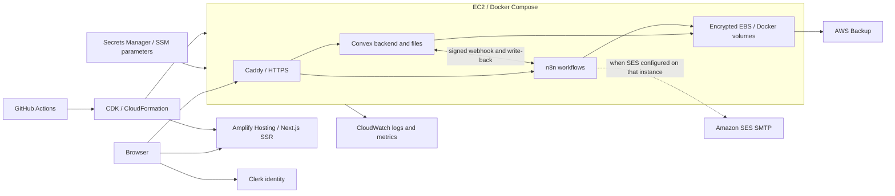

# AWS infrastructure and deployment

This is the inventory defined by the repository, reviewed on 2026-11-03. It is not a live AWS audit: stack outputs, deployment status, alarm subscriptions, SES production access and backups must be checked in the account. The source of truth is [infra/bin/app.ts](../../infra/bin/app.ts), [infra/lib/config.ts](../../infra/lib/config.ts), and the stack classes under `infra/lib/`.

## Account, region and endpoints

| Setting | Configured value |
|---|---|
| AWS account | `571787168993` |
| Region | `eu-north-1` (Stockholm) |
| Repository / production branch | `ayenisholah/fluencetraining` / `main` |
| Web application | `https://lendloop.sholaayeni.xyz` |
| Convex client API and WebSocket sync | `https://convex.lendloop.sholaayeni.xyz` |
| Convex HTTP actions | `https://site.lendloop.sholaayeni.xyz` |
| n8n editor and production webhooks | `https://n8n.lendloop.sholaayeni.xyz` |
| Resource tags | `project=lendloop`, `environment=production`, `managedBy=cdk` |

Namecheap hosts DNS. Clerk supplies identity and sessions; neither service is provisioned by CDK. SES authenticates `sholaayeni.xyz`, which is distinct from the application's `lendloop.sholaayeni.xyz` hostname.

## Architecture

**Email:** n8n on the host sends through Amazon SES (`notifications@sholaayeni.xyz`). Bootstrap imports the SES SMTP credential from Secrets Manager and renders the workflows for SES on every deploy; Mailpit only runs if `config.mailProvider` is set to `"mailpit"`. See [SES SMTP › Production](ses-smtp.md#production-ec2), including the sandbox limits.

## Stacks and AWS services

| Stack / service | Resources and purpose |
|---|---|
| `LendLoop-Backend` / EC2 | One `t4g.small` ARM64 Amazon Linux 2023 host; AMI lookup cached in `infra/cdk.context.json`; IMDSv2 required; API termination protection enabled. |
| VPC, security group, Elastic IP | Existing default VPC and a public subnet; one Elastic IP; inbound TCP 80/443 from IPv4/IPv6; no SSH ingress; outbound traffic allowed. No load balancer or private-subnet NAT is created. |
| EBS | Encrypted 30 GiB gp3 root volume containing Docker volumes for Convex, n8n and Caddy certificates. This is a single-host deployment, not a multi-AZ database or worker cluster. |
| S3 CDK assets | Versioned-by-content deployment bundles for `deploy/ec2/` and `n8n/`, uploaded through the CDK bootstrap asset bucket. These are deployment assets, not application photo storage; photos live in self-hosted Convex storage. |
| Systems Manager | Session Manager replaces SSH. Run Command refreshes the host. Parameter Store publishes bundle URLs, the base domain and app URL. |
| Secrets Manager | Retained generated service secrets plus the host-generated Convex admin key. Operator-provided GitHub and Clerk secrets are referenced by the web stack. |
| CloudWatch Logs and agent | Four retained service log groups with one-month retention; agent publishes memory/disk metrics. Docker's `awslogs` driver uses the host role. |
| AWS Backup | Retained vault `lendloop-prod`; plan `lendloop-prod-daily` selects the EC2 instance, schedules backups at 02:30 UTC, and expires recovery points after seven days. |
| EC2 recovery alarm | Two consecutive one-minute system-status failures trigger EC2 recovery. This is separate from the operational SNS alerts. |
| `LendLoop-Web` / Amplify Hosting | `WEB_COMPUTE` Next.js SSR app, production `main` branch with automatic builds; custom domain association and certificate/DNS validation. Delivery infrastructure is managed by Amplify rather than a separately declared CloudFront distribution. |
| `LendLoop-Observability` / CloudWatch | Dashboard `LendLoop-Prod`, host/application alarms, log metric filters and composite alarm. |
| CloudWatch Synthetics and S3 | Three canaries every 15 minutes. Encrypted, private artifact bucket with a 14-day expiration policy; run retention seven days for success and fourteen for failure. |
| SNS | SSL-enforced topic `lendloop-prod-alerts`. Alarm and recovery notifications are attached; the stack subscribes the `ALERT_EMAIL` repository variable by email (one-time confirmation). |
| `LendLoop-Deployer` / IAM | User `lendloop-github-deployer` for GitHub Actions; can assume account/region CDK bootstrap roles and perform listed deployment operations. Access keys are created separately. |
| SES / IAM SMTP user | Manually configured outside these stacks: domain identity, DKIM, custom MAIL FROM, SMTP IAM user and restricted send policy. See [SES configuration](ses-smtp.md). |

CloudFormation orchestrates the four stacks. The CDK bootstrap stack provides the asset bucket and deployment roles; bootstrap infrastructure is a prerequisite, not one of the four application stacks. Encryption is configured for EBS and the canary bucket; the code does not define a dedicated customer-managed KMS key.

## Host routing and persistent state

[Production Compose](../../deploy/ec2/docker-compose.prod.yml) runs Caddy `2.10.2-alpine`, n8n `2.45.7`, Mailpit `v1.33.0` (only with the `mailpit` profile), and a digest-pinned Convex image. Only Caddy publishes internet-facing ports. Convex also binds ports 3210/3211 to host loopback for administration and metrics. n8n and Mailpit publish no host ports.

[Caddy](../../deploy/ec2/Caddyfile) obtains Let's Encrypt certificates, sets security headers and emits JSON access logs. `/ops/*` on the HTTP-actions hostname returns 404 externally. `/webhook/*` on the n8n hostname bypasses Basic Auth but must pass workflow HMAC verification; the editor and other paths require Basic Auth (`admin`) in addition to n8n's own owner login. The Basic Auth password comes from `N8N_EDITOR_PASSWORD`.

Files live under `/opt/lendloop`; `/etc/lendloop.env` holds non-secret bootstrap settings. Bootstrap writes `/opt/lendloop/.env` with mode 600. Persistent named volumes are `lendloop_convex-data`, `lendloop_n8n-data` and `lendloop_caddy-data`. Retain the matching secrets when restoring these volumes, particularly `N8N_ENCRYPTION_KEY` and the Convex instance secret. Stack and instance termination protection do not replace tested backups.

## Secrets, parameters and identities

All secret names below are prefixed with `lendloop/prod/`; never place values in documentation, Git, PRs or command logs.

| Secret | Creation and consumers |
|---|---|
| `CONVEX_INSTANCE_SECRET` | CloudFormation generates an alphanumeric value; bootstrap SHA-256 hashes it into the hex `INSTANCE_SECRET` used by Convex. Preserve this transformation across updates/restores. |
| `N8N_ENCRYPTION_KEY` | Generated; used to encrypt n8n credentials in its volume. |
| `LENDLOOP_TO_N8N_SECRET`, `N8N_TO_LENDLOOP_SECRET` | Generated; separate HMAC keys for the two directions. Host and Convex environment must agree. |
| `OPS_METRICS_SECRET` | Generated; shared by Convex's metrics endpoint and host poller. |
| `N8N_EDITOR_PASSWORD` | Generated; bootstrap hashes it for Caddy Basic Auth. |
| `CONVEX_ADMIN_KEY` | Initialized as `pending`; host writes the generated admin key after Convex first becomes healthy. CI reads it for deployments. |
| `GITHUB_AMPLIFY_TOKEN` | Operator supplies through `put-external-secrets.sh`; lets Amplify read the repository. |
| `CLERK_SECRET_KEY` | Operator supplies a production `sk_live_` key; Amplify reads it during the build into `.env.production`. |

SSM parameter names: `/lendloop/prod/bundle/ec2`, `/lendloop/prod/bundle/n8n`, `/lendloop/prod/base-domain`, `/lendloop/prod/app-url`.

The host role has SSM/CloudWatch managed policies, scoped secret/asset/parameter access, and permission to write the Convex admin key. The Amplify build role reads the Clerk secret and writes Amplify logs. The GitHub deployer can assume CDK bootstrap roles, read stack outputs and four deployment secrets, send commands to the specific host, inspect command results, and start/read Amplify jobs. CDK role assumption is a powerful deployment capability; it is not a runtime application role. Code comments record an organization SCP restriction on GitHub OIDC as the reason for the IAM-user approach; verify that restriction before redesigning authentication.

## Deploy steps (production)

1. Authenticate AWS tooling for account `571787168993` / `eu-north-1`. Install Node 22, npm, AWS CLI, GitHub CLI, `jq`, `curl`, `unzip` and DNS tooling (`dig`). Confirm the default VPC and CDK bootstrap exist. Review `infra/cdk.context.json` before deliberately refreshing the AMI; replacing this host can affect its data.
2. Set GitHub repository variables `AWS_REGION=eu-north-1`, `NEXT_PUBLIC_CLERK_PUBLISHABLE_KEY` (production key), and `CLERK_JWT_ISSUER_DOMAIN` (same production Clerk instance). Configure Clerk's Convex JWT template and production domains/redirects. Development credentials stay in the local test environment.
3. Run `bash scripts/aws/put-external-secrets.sh` to supply the GitHub token and Clerk secret. The script reads the Clerk key through a hidden prompt. Then run `bash scripts/aws/put-external-secrets.sh --ses` to store the SES SMTP credential ([SES SMTP](ses-smtp.md#production-ec2)).
4. Validate infrastructure with `npm ci --prefix infra` and `npm run typecheck --prefix infra`. Review a CDK synthesis/diff before deploying. `bash scripts/aws/deploy-infra.sh` deploys all stacks; optional arguments select stacks. It prints a diff but proceeds with `--require-approval never`, even if the diff command fails. It is not a dry run. Outputs are written to ignored `infra/cdk.outputs.json`.
5. Run `bash scripts/aws/dns-records.sh` and add the printed records in Namecheap. Run it again to check public DNS. A first custom-domain deployment may wait for these records while CloudFormation/Amplify is still provisioning.
6. Run `bash scripts/aws/configure-backend.sh`. It waits for HTTPS and the admin key, sets Convex's Clerk/HMAC/metrics/app-URL environment, deploys functions, and runs `migrations:backfillSearch`. The optional `--seed` adds sample catalogue data; omit it for a real production catalogue.
7. Run `bash scripts/aws/refresh-host.sh`. It uses SSM to download current assets, run bootstrap (including the SES credential and workflow import), and restart/update containers; it is not a data migration.
8. Create/protect the GitHub `production` environment, restrict deployment branches to `main`, and configure required reviewers if desired. `bash scripts/aws/create-deploy-key.sh` stores the deployer's key in its `AWS_ACCESS_KEY_ID` and `AWS_SECRET_ACCESS_KEY` environment secrets, then deletes old keys. It needs a free IAM access-key slot and permission to manage keys/secrets.
9. Perform the release smoke checks in [deployment.md](deployment.md#deploy-steps-production), verify monitoring and recovery points, and confirm the alarm email subscription (repository variable `ALERT_EMAIL`). These are checks to perform, not claims that subscription/restore verification already happened.

The [Deploy workflow](../../.github/workflows/deploy.yml) runs after successful `CI` on `main`, or by manual dispatch. It checks out the triggering commit, installs dependencies, deploys CDK, configures Convex and refreshes the host. It uses the GitHub `production` environment; approval depends on repository environment settings, not YAML alone. Restrict manual runs to `main` through those settings.

**Separate frontend trigger:** Amplify's `main` branch has `enableAutoBuild: true`. Its frontend build starts on a push independently of the GitHub production environment gate. The workflow grants permission to start an Amplify job but does not call `StartJob`. The Amplify build uses Node 22, `npm ci`, fetches the Clerk secret into `.env.production`, appends public variables, and runs `npm run build`.

## DNS ownership

| Record purpose | Namecheap record |
|---|---|
| App | CNAME host `lendloop` to the target returned by Amplify |
| Backend | A records `convex.lendloop`, `site.lendloop`, `n8n.lendloop` to the backend stack's `PublicIp` |
| Amplify certificate | Validation CNAME printed by `dns-records.sh` |
| Clerk production domain | CNAMEs printed from Clerk by `dns-records.sh`; it reads the production Clerk key without printing it |
| SES DKIM | Three CNAMEs from the SES domain identity; separate from the deployment DNS helper |
| SES custom MAIL FROM | MX and SPF TXT at `bounce.sholaayeni.xyz`; see SES authentication records in the console |

Route 53 is not used by these stacks. Keep the existing `send.sholaayeni.xyz` mail records when changing `bounce` records. No DNS record values containing secrets are needed.

## Rollback and recovery

Revert application changes through a reviewed commit on `main`; Amplify builds the resulting commit. Redeploy compatible Convex functions and review schema compatibility before a backend rollback. Reverting CDK or host bundles can replace or reconfigure stateful resources, so inspect the diff and available backup before applying it. Re-importing old n8n templates can also change the selected SMTP provider.

For host/data recovery, use a known AWS Backup recovery point, preserve corresponding Secrets Manager values, restore into a controlled replacement host/volume, verify the containers and data, then deliberately reassign the Elastic IP and update stack references. No automatic restore orchestration or tested RTO/RPO is encoded here. Daily seven-day backups are the configured schedule, not a guarantee of a successful recovery point. Logs, secrets and the backup vault have retention-on-stack-removal policies; the canary artifact bucket is destroyed and emptied with its stack.

`reset-empty-convex.sh` is only for a failed first initialization while `CONVEX_ADMIN_KEY` is still `pending`; it deletes the Convex Docker volume. It is not a production data-restore tool. Never reset the admin-key secret to bypass that guard.

## Ongoing resource usage

Review EC2, EBS, public IPv4, Amplify builds/SSR/transfer, Secrets Manager, CloudWatch logs/custom metrics/alarms/dashboard, Synthetics runs and artifacts, AWS Backup recovery points, S3 assets, SNS and SES usage in billing. There are no budget alerts or cost ceilings declared in the application stacks. This inventory does not estimate current spend.
