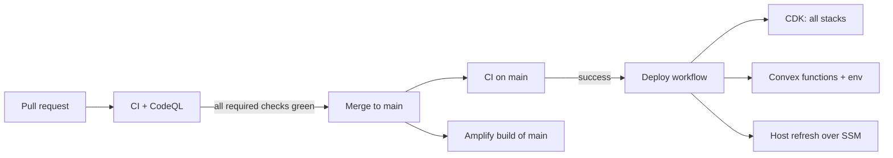

# CI/CD

How code gets from a pull request to production at **https://lendloop.sholaayeni.xyz**. The infrastructure itself is described in [aws-deployment.md](aws-deployment.md). Monitoring is in [observability.md](observability.md).

**In short:**
- Pull requests are checked but never deployed.
- Every push to `main`, including a merged PR, deploys automatically once CI passes. There is no manual approval step.

## Workflows

| Workflow | Trigger | What it does |
|---|---|---|
| [`ci.yml`](../../.github/workflows/ci.yml) | every PR, push to `main` | **check**: lint, typecheck, unit/component/Convex tests, WCAG contrast, no credentials in n8n exports, production build, no secrets in the client bundle, no broken public links. **storybook**: builds Storybook, then runs the story tests (render, play functions, axe). **e2e**: signed-out Playwright suite against a real build. |
| [`codeql.yml`](../../.github/workflows/codeql.yml) | PRs, push to `main`, weekly (Mon 04:23 UTC) | CodeQL `security-extended` for JavaScript/TypeScript. |
| [`deploy.yml`](../../.github/workflows/deploy.yml) | CI succeeded on a **push** to `main`; or `workflow_dispatch` | Production deploy, below. |
| Amplify (not a workflow) | push to `main` | Amplify Hosting builds and serves the Next.js app (SSR). It is independent of `deploy.yml`. |
| Dependabot ([config](../../.github/dependabot.yml)) | weekly | Grouped update PRs for npm, GitHub Actions and Docker. They go through CI like any PR. |

### The deploy job
1. Check out the exact commit CI tested (`workflow_run.head_sha`).
2. Configure AWS credentials from the `production` environment secrets.
3. **Infrastructure:** `scripts/aws/deploy-infra.sh`. This runs a strict synth, a diff, then `cdk deploy` of every stack. Unchanged stacks are no-ops.
4. **Convex:** `scripts/aws/configure-backend.sh`. This sets the Convex environment from Secrets Manager, runs `convex deploy` and the search backfill.
5. **Host:** `scripts/aws/refresh-host.sh`. SSM Run Command re-runs `deploy/ec2/bootstrap.sh`, which:
   - pulls the latest bundle and n8n workflows;
   - rewrites the root-only `.env`;
   - updates the containers;
   - imports and publishes the n8n workflows. It fails unless all three exist.

`concurrency: deploy-production` runs deploys one at a time, in order, and never cancels one in flight.

### Why only push-triggered CI deploys
`workflow_run` also fires for CI runs on pull requests. A fork's PR from a branch called `main` reports `head_branch: main`. The job therefore requires `workflow_run.event == 'push'`, which means a commit that actually landed on `main`.

## Guard rails

- **Ruleset "Protect main":** changes arrive only through a PR, history stays linear, and force-pushes and deletion are blocked. The required checks are `check`, `storybook` and `Analyze (JavaScript/TypeScript)`.
- **`production` environment:** only protected branches, meaning `main`, may deploy. There is no required reviewer; merging is the approval.
- **Least privilege:**
  - workflows default to `permissions: contents: read`;
  - only CodeQL's analyze job gets `security-events: write`;
  - checkouts use `persist-credentials: false`.
- **Pinned actions:** every third-party action is pinned to a full commit SHA, with the version in a comment. Dependabot proposes bumps.
- **Fork PRs:**
  - fork PRs never receive secrets. The e2e job runs only for pushes and same-repository PRs, and is skipped, not failed, when its secrets are absent;
  - there is no `pull_request_target`.
- **Repository security:** secret scanning with push protection, Dependabot alerts, CodeQL and private vulnerability reporting ([SECURITY.md](../../SECURITY.md)).

## Secrets and variables

| Name | Kind | Scope | Used by |
|---|---|---|---|
| `AWS_ACCESS_KEY_ID`, `AWS_SECRET_ACCESS_KEY` | secret | `production` environment | deploy: the `lendloop-github-deployer` key |
| `E2E_CLERK_SECRET_KEY`, `E2E_CLERK_PUBLISHABLE_KEY`, `E2E_CONVEX_URL` | secret | repository | CI e2e (Clerk **development** instance) |
| `AWS_REGION` | variable | repository | deploy (`eu-north-1`) |
| `NEXT_PUBLIC_CLERK_PUBLISHABLE_KEY` | variable | repository | deploy and local `deploy-infra.sh`: the **production** Clerk instance (public by design) |
| `CLERK_JWT_ISSUER_DOMAIN` | variable | repository | deploy and local `configure-backend.sh`: `https://clerk.sholaayeni.xyz` |
| `ALERT_EMAIL` | variable | repository | deploy and local `deploy-infra.sh`: email subscribed to the `lendloop-prod-alerts` topic (optional) |

The application's runtime secrets never live in GitHub. They are generated by CloudFormation in Secrets Manager, or supplied once by the operator with `scripts/aws/put-external-secrets.sh`. The deploy job reads only the ones it must pass to Convex.

## The deployer identity
The organisation's SCP denies `iam:CreateOpenIDConnectProvider`, so GitHub OIDC isn't possible (see [ADR 0013](../architecture/adr/0013-scoped-iam-deployer.md)). GitHub instead uses the IAM user `lendloop-github-deployer`, defined in `infra/lib/deployer-stack.ts`. It can only:
- assume the CDK bootstrap roles;
- read the `LendLoop-*` stack outputs and four deployment secrets;
- run `AWS-RunShellScript` on the one host, and read the results;
- start and read Amplify jobs.

**Rotation:** `bash scripts/aws/create-deploy-key.sh` creates a new key, pipes it straight into the `production` environment secrets and deletes the old keys. Rotate it whenever someone with access leaves, or at least every 90 days.

## Everyday tasks

| Task | How |
|---|---|
| Ship a change | Open a PR, wait for green checks, merge. Production updates by itself. |
| Re-deploy without a code change | Actions → Deploy → **Run workflow** on `main` (`workflow_dispatch`). |
| Roll back | Revert the commit on `main` through a PR. The deploy re-applies the previous state. To restore the web app straight away, redeploy an earlier successful job in the Amplify console. |
| Watch a deploy | The repository's **Deployments → production** panel links the run and the live URL. |
| See why the host refresh failed | `journalctl -t lendloop-bootstrap` on the instance (SSM Session Manager), or the error the job prints. |

## First-time setup (once per account)
These steps are run by an operator with AWS administrator rights, in order:

1. `bash scripts/aws/put-external-secrets.sh` stores the GitHub token and the Clerk production key.
2. `bash scripts/aws/deploy-infra.sh` creates the stacks.
3. `bash scripts/aws/dns-records.sh` lists the Namecheap records. Add them and re-run until every row says OK ([ADR 0014](../architecture/adr/0014-custom-domain-dns-in-namecheap.md)).
4. `bash scripts/aws/refresh-host.sh`, then `bash scripts/aws/configure-backend.sh --seed`.
5. `bash scripts/aws/create-deploy-key.sh` gives GitHub its deploy key.

From then on, merging to `main` is the whole deployment process.

**Recovery:** if Convex's very first start fails (e.g. a bad instance secret), `scripts/aws/reset-empty-convex.sh` recreates its volume. It only does so while the admin key is still `pending`, which proves there is no data.
