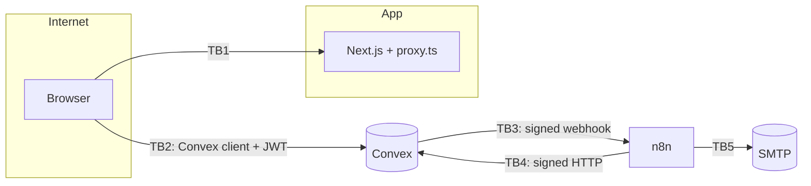

# Threat model

STRIDE per trust boundary. For each threat: the mitigation, the test that checks it, and what risk remains.

## TB1/TB2: Browser ↔ app and Convex

| STRIDE | Threat | Mitigation | Test | Residual risk |
|---|---|---|---|---|
| Spoofing | Acting as another user | Identity only from the Clerk JWT (`ctx.auth`), never from arguments | `convex/access.test.ts` | Compromised Clerk account |
| Tampering | Editing someone else's listing or loan | `requireToolOwner` / `requireLoanParty`; validators reject extra fields like `ownerId`, `status` or `role` | `convex/access.test.ts` (deny matrix) | — |
| Elevation | Becoming admin | Role never set from the client; `setRole` is internal; coverage guard on every public function | `convex/access.test.ts` | Operator with the Convex admin key |
| Information disclosure | Seeing others' emails or private fields | Public list is name and category only; others see a first name; emails for admins only | `convex/public.test.ts`, `convex/workflow.test.ts` | Admins see emails by design |
| Tampering (XSS) | Injected script in tool text or uploads | React escaping; strict nonce CSP; plain-text rule on names and descriptions; raster images only (no SVG) | `e2e/public.spec.ts` (CSP), `convex/rules.test.ts`, `convex/images.test.ts` | — |
| Tampering | Clickjacking | `frame-ancestors 'none'` and `X-Frame-Options: DENY` | `e2e/public.spec.ts` | — |
| Spoofing | Open redirect via `X-Forwarded-Host` | HTTPS redirect target comes from `NEXT_PUBLIC_SITE_URL` only; path set as a component | `lib/https.test.ts` | — |
| Denial of service | Spamming listings, uploads or requests | Per-user hourly rate limits; upload URL shares the listing limit; search capped at 100 chars | `convex/rbac.test.ts` | Distributed abuse (production: global limits) |

## TB3/TB4: Convex ↔ n8n

| STRIDE | Threat | Mitigation | Test | Residual risk |
|---|---|---|---|---|
| Spoofing | Forged webhook to n8n, or forged write-back to Convex | HMAC-SHA256 over the raw body, a separate secret per direction, constant-time compare | `convex/automation.test.ts`, `n8n/workflows.test.ts`, `e2e/automation.spec.ts` | Leaked secret (rotate: runbook) |
| Tampering | Replay of a captured request | 5-minute window; non-numeric timestamps rejected; idempotent write-backs | as above | Replay within 5 min of a read-only call |
| Information disclosure | Personal data in payloads or logs | Minimal payload (recipient email and first names only); the outbox stores ids; the error workflow copies no item data | `convex/automation.test.ts`, `n8n/workflows.test.ts` | Email provider sees recipient addresses |
| Denial of service | Large bodies | 16 KB cap checked from `Content-Length` before reading, then in bytes | `convex/automation.test.ts` | — |
| Repudiation | Failures going unnoticed | Outbox status, error workflow, Admin › Automation health | `e2e/automation.spec.ts` | Failure of the error workflow itself |

## TB5: n8n ↔ SMTP

| Threat | Mitigation | Residual risk |
|---|---|---|
| Header injection through tool names or display names | Control and bidi characters refused or stripped server-side | — |
| HTML injection into emails through tool names or names | Every user value is HTML-escaped by the Convex templates (`convex/lib/email/layout.ts`); emails contain no scripts or styles blocks | `convex/lib/email/email.test.ts` |
| Credential leakage | SMTP credentials in n8n credentials; the export stub has no password; CI fails on secrets in exports | Self-hosted n8n with env access in Code nodes (production: `N8N_BLOCK_ENV_ACCESS_IN_NODE=true` with credentials) |

## Supply chain
`npm audit --omit=dev` is clean; dev-only advisories (glob/minimatch ReDoS) don't ship. Docker images are pinned except Convex's `latest` (pin in production).
