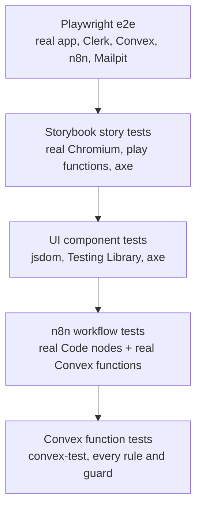

# Test plan

## Strategy

Most rules are checked once, at the cheapest level that can prove them: authorisation and data rules in Convex tests, presentation in UI tests, integration in Playwright.

## Suites

| Suite | Command | Environment | What it covers |
|---|---|---|---|
| Convex | `npm run test:convex` | edge-runtime, `convex-test` | Guards and the coverage guard, validation, loan workflow, search and pagination, photos, HTTP endpoints, outbox, email templates, seed and purge |
| UI | `npm run test:ui` | jsdom; `test/convex-mock.ts` and `test/next-navigation-mock.ts` | Every screen and design-system component, URL state, dialogs, axe |
| n8n | `npm run test:n8n` | Node | Exported workflow JSON and Code nodes; Convex ⇄ n8n round trips |
| Storybook | `npm run test:storybook` | real Chromium | Every story renders, play functions pass, axe |
| Playwright public | `npm run test:e2e:public` | built app (no stack needed) | Landing, sign-in modal, legal pages, CSP, redirects, phone layout |
| Playwright signed-in | `npx playwright test --project signed-in` | Docker stack + Clerk dev keys | Lend/borrow flow, photos, search, views, dialogs, admin, automation, Clerk sign-in redirect |
| Local automation recovery | `npm run test:automation` | Docker stack + Clerk dev keys; temporarily stops Mailpit | Email delivery, activity write-back, SMTP failure and automatic recovery; see [runbook](../operations/runbook.md#verify-local-notifications) |
| Static checks | `npm run lint`, `npm run typecheck`, `npm run check:contrast`, `npm run check:bundle`, `npm run check:links` | Node | Code quality, WCAG contrast, secret-free bundle, links |

`npm test` runs Convex, UI and n8n together. CI runs everything except the signed-in Playwright project, which needs the local stack.

## Coverage by area

| Area | Convex | UI | n8n | Storybook | Playwright |
|---|---|---|---|---|---|
| Public board | `public.test` | `Home.test` | | | `public.spec`, `signed-in.spec` |
| Listings and photos | `workflow.test`, `images.test` | `ToolForm.test`, `Listings.test` | | Domain | `signed-in.spec` |
| Board, search, views | `search.test`, `pagination.test` | `Tools.test` | | Board | `signed-in.spec` |
| Loans | `workflow.test` | `LoanList.test` | | Domain | `signed-in.spec` |
| Roles | `access.test`, `rbac.test` | `Admin.test` | | | `admin.spec` |
| Automation | `automation.test` | | `workflows.test`, `roundtrip.test` | | `automation.spec` |
| Security | `access.test`, `rules.test`, `images.test` | | `workflows.test` | | `public.spec` (CSP) |
| Accessibility | | axe everywhere | | axe on every story | axe on every page |

## Concurrency

See [Lending concurrency and race conditions](concurrency.md) for the scenario matrix,
transaction guarantees, test limitations, and cleanup. `npm run test:concurrency`
uses independent clients against local Convex; `npm run test:concurrency:ui` checks
stale screens with real Clerk sessions. In-memory transaction tests alone are not
evidence of real backend contention.

## Test data
- Convex and UI tests create their own data in memory.
- Playwright uses Clerk `+clerk_test` users (created by `e2e/global.setup.ts`; code `424242`) and uniquely named `E2E …` tools that each spec deletes when it finishes (`dev:purgeTestData`).
- `npx convex run dev:seedNeighbourhood` provides the sample catalogue.

## Entry and exit criteria
- **Entry:** the branch typechecks and lints.
- **Exit (release):** every suite green, the signed-in project run locally against the stack, and the [release checklist](../operations/release-checklist.md) complete.

## Local automation verification (2026-11-03)

`npm run test:automation`: **12 passed** (two Clerk setup checks and ten automation
scenarios), including a temporary Mailpit outage followed by automatic outbox
retry, exactly one recovered request email and a successful activity write-back.
The run took about five minutes; recovery follows real retry backoff.
`npx vitest run --project convex --project n8n convex/automation.test.ts n8n/`:
**52 passed**. Type checking and lint for the automation spec also passed.

Historical DNS/SMTP errors remain in Admin after recovery. This result verifies
local Mailpit delivery, not delivery to an external email provider or exactly-once
email under overlapping executions.
